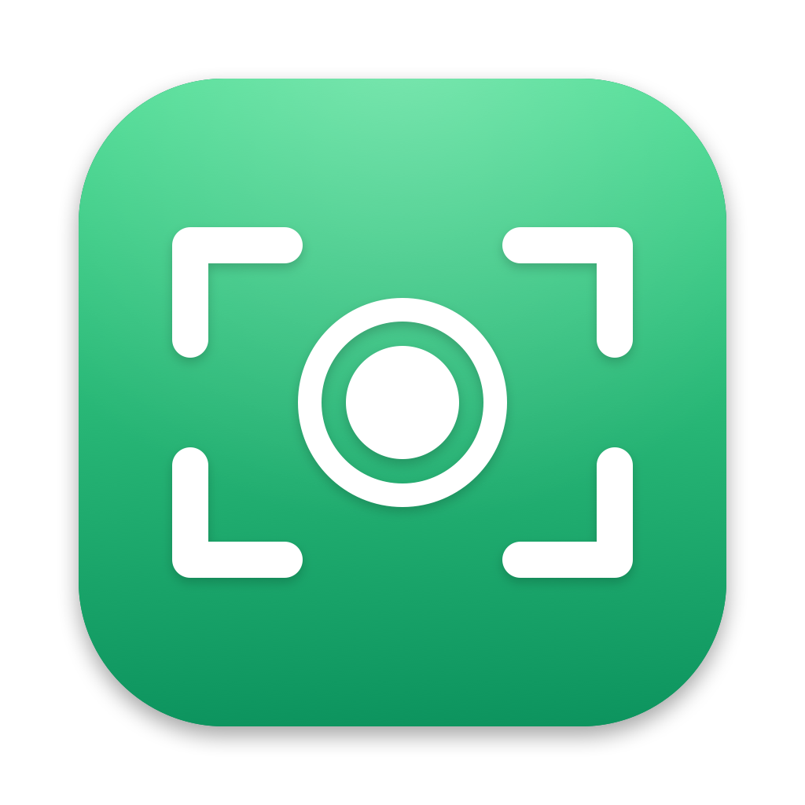

# Record Everything

Bildschirm-, Webcam- und Audiorekorder für macOS: Bereich oder Fenster aufziehen, Ton von System und
Mikrofon mitschneiden, Aufnahmen in einer Bibliothek verwalten, abspielen und schneiden.

**Download:** [Record-Everything.dmg](https://github.com/fte-one/record-everything/releases/latest/download/Record-Everything.dmg)
(neueste Version, signiert und notarisiert). Die App aktualisiert sich danach selbst.

## Funktionen

- **Screenshot und markieren** (⌘←): Bereich aufziehen oder Fenster anklicken, dann Editor mit Pfeil,
  Rechteck, Ellipse, Marker, Stift, Text, Verpixeln und Zuschneiden; danach „Hochladen“ (Link in die
  Zwischenablage) oder „Kopieren“ (Bild in die Zwischenablage).
- **Screenshot und Link kopieren** (⌘→): Das Bild landet auf Cloudflare R2, der Link ist sofort in der
  Zwischenablage.
- **Screenshot und Bild kopieren**: ein Klick, das Bild liegt in der Zwischenablage.
- **Menüleiste als Zentrale**: Das Menü bündelt die drei Screenshot-Aktionen, Bildschirm-, Kamera-
  und Audioaufnahme sowie umschaltbar die letzten **Uploads** (Link kopieren, im Browser öffnen) und die
  **Aufnahmen** (öffnen, schneiden, hochladen, im Finder zeigen, AirDrop, löschen). Wahlweise ohne
  Dock-Symbol.

- **Bildschirm**: Vollbild-Overlay mit Fenstererkennung, frei aufziehbarem Bereich, Griffen, Lupe mit
  Koordinaten und Seitenverhältnissen (3:4, 4:3, 9:16, 16:9, ganzer Bildschirm, frei). Leiste mit
  Breite × Höhe, Auflösung (720P bis 4K), Bildrate (15 bis 60 FPS) sowie Schaltern für Mauszeiger,
  Webcam, Systemton und Mikrofon (mit Geräteauswahl und Pegel).
- **Aufnahme**: 3-Sekunden-Countdown, gestrichelter Rahmen, schwebende Steuerleiste (Mikrofon,
  Zeit, Pause, Stopp; blendet sich ab), Webcam-Bubble zum Verschieben und Skalieren, Zeit in der
  Menüleiste, Ruhezustand wird verhindert.
- **Kamera** und **Audio** als eigene Fenster, Audio mit Segment-Pegelanzeige; Audio landet als `.m4a`.
- **Aufnahmen-Liste** im Menüleisten-Popup mit Vorschaubild, Größe, Dauer und Format; Löschen wahlweise
  mit Datei.
- **Info-Fenster** mit Player und Metadaten, Umbenennen (auch der Datei).
- **Editor**: Zeitleiste mit Vorschaubildern, Auswahl mit Griffen, „Nur Auswahl behalten“,
  „Auswahl entfernen“, Widerrufen, Ton aus; Sichern oder Sichern unter.
- **Globale Hotkeys** (Standard ⌘1 Start/Pause, ⌘2 Stopp), in den Einstellungen änderbar;
  Speicherort, Start bei Anmeldung.
- **Online-Updates** über Sparkle und GitHub Releases (täglich automatisch oder über
  „Nach Updates suchen …“).
- Oberfläche auf Deutsch und Englisch.

Technik: ScreenCaptureKit für Bild und Systemton, AVCaptureSession für Kamera und Mikrofon,
AVAssetWriter mit H.264 (High, CABAC, Keyframe alle 2 s, Bitrate B × H × FPS × 0,08) und AAC 48 kHz.
Pausen werden über Zeitstempel-Versatz herausgeschnitten; System- und Mikrofonton werden beim Stoppen
zu einer Spur gemischt. Aufnahmen landen in `~/Movies/Record Everything`.

## Voraussetzungen

- macOS 15 oder neuer (Apple Silicon und Intel)
- Zum Bauen: Xcode **oder** nur die Command Line Tools (`xcode-select --install`)

## Bauen

```bash
./scripts/build-app.sh
```

Das Ergebnis liegt in `build/Record Everything.app`. Beim ersten Build lädt `scripts/fetch-sparkle.sh`
das Update-Framework Sparkle (Version fest eingestellt) nach `Vendor/`. Varianten:

```bash
CONFIG=debug ./scripts/build-app.sh                  # schneller Debug-Build
ARCHS="arm64 x86_64" ./scripts/build-app.sh          # Universal-Binary
SIGN_IDENTITY=- ./scripts/build-app.sh               # ad hoc signieren
```

Hinweise zur Toolchain:

- Gebaut wird direkt mit `swiftc`, ohne SwiftPM: Das Manifest-API der installierten Command Line Tools
  ließ sich nicht linken.
- Im macOS-27-SDK ist `@State` ein Makro, dessen Plugin nur mit Xcode ausgeliefert wird. Ohne Xcode
  baut das Skript deshalb gegen das neueste macOS-26-SDK der Command Line Tools (`SDK=…` überschreibt).

## Signieren und Veröffentlichen

`build-app.sh` signiert automatisch mit der ersten „Developer ID Application“-Identität im
Schlüsselbund, mit Hardened Runtime und den Entitlements aus `Support/RecordEverything.entitlements`
(Kamera und Mikrofon), Sparkle von innen nach außen. Eine feste Identität sorgt dafür, dass macOS die
Freigaben für Bildschirmaufnahme und Mikrofon über Neubauten hinweg behält.

Eine neue Version veröffentlichen:

```bash
./scripts/release.sh 1.0.1
```

Das Skript

1. setzt die Version in `Support/Info.plist` und erhöht die Build-Nummer,
2. baut ein Universal-Binary (arm64 + x86_64) und signiert App und DMG mit Zeitstempel,
3. notarisiert die DMG über `notarytool` (Schlüsselbund-Profil `NOTARY_PROFILE`, Standard
   `crispyflow-notary`) und heftet die Tickets an App und DMG,
4. erzeugt `appcast.xml`, signiert mit dem EdDSA-Schlüssel aus dem Schlüsselbund (Konto
   `record-everything`),
5. fragt nach, committet die Version, pusht und legt das GitHub-Release `v<Version>` an mit
   `Record-Everything-<Version>.dmg`, `Record-Everything.dmg` (fester Download-Link) und `appcast.xml`.

Release-Notizen werden aus den Commits erzeugt, oder aus `release-notes/<Version>.md`, falls vorhanden.
Weitere Schalter: `PUBLISH=0` (nicht veröffentlichen), `YES=1` (ohne Rückfrage), `SKIP_NOTARIZE=1`
(nur signierte DMG für lokale Tests, wird nie veröffentlicht).

Meldet Apple bei der Notarisierung **HTTP 403 „agreement missing or expired“**, muss der Account Holder
des Teams die aktuelle Programmvereinbarung auf [developer.apple.com/account](https://developer.apple.com/account)
und in App Store Connect akzeptieren.

### Wie die Updates funktionieren

Die App liest `SUFeedURL` aus der Info.plist:
`https://github.com/fte-one/record-everything/releases/latest/download/appcast.xml`. GitHub leitet
`latest` immer auf das neueste Release um, dessen Appcast auf die DMG dieses Releases zeigt. Sparkle
prüft vor der Installation die EdDSA-Signatur gegen `SUPublicEDKey` und die Developer-ID-Signatur der
neuen App. Das Repo muss dafür öffentlich sein.

> **Schlüssel sichern:** Der private EdDSA-Schlüssel liegt nur im Login-Schlüsselbund. Geht er
> verloren, können installierte Apps keine Updates mehr annehmen. Sicherung:
> `Vendor/bin/generate_keys --account record-everything -x record-everything-sparkle.key`
> (Datei an einem sicheren Ort aufbewahren, nicht ins Repo).

Test ohne GitHub: einen lokalen Appcast bereitstellen und die App mit
`open "build/Record Everything.app" --args -RecordEverythingFeedURL http://127.0.0.1:8765/appcast.xml`
starten.

## Hochladen einrichten (Cloudflare R2)

1. Im Cloudflare-Dashboard unter **R2 › API-Tokens verwalten** ein Token mit „Object Read & Write“ für
   den Bucket anlegen. Es liefert Access Key ID und Secret Access Key.
2. In Record Everything: **Einstellungen › Hochladen**: Account-ID, Bucket, die beiden Schlüssel und die
   öffentliche URL eintragen, unter der die Dateien des Buckets erreichbar sind (z. B. eine eigene Domain
   oder die `r2.dev`-Adresse des Buckets, etwa `https://example.com/files/`), dann
   „Sichern & Verbindung testen“. Ab Werk ist nichts vorbelegt.

Die Schlüssel liegen im Schlüsselbund. Hochgeladen wird über die S3-API von R2
(`https://<Account-ID>.r2.cloudflarestorage.com`, Signatur v4). Der Dateiname folgt dem Muster
`%month%%random-5%` (z. B. `10aB3xZ.png`); weitere Platzhalter: `%random-N%`, `%day%`, `%year%`,
`%date%`, `%time%`, `%filename%`. Andere S3-kompatible Speicher gehen über „Endpunkt“ und „Region“.

## Berechtigungen

Beim ersten Start fragt macOS nach:

- **Bildschirm- & Systemaudioaufnahme** (Datenschutz & Sicherheit). Ohne diese Freigabe zeigt die App
  einen Hinweis mit Link in die Systemeinstellungen; danach die App neu starten.
- **Mikrofon** und **Kamera**, sobald sie zum ersten Mal genutzt werden.

## Selbsttest

Prüft die Aufnahme-Engine ohne Bedienung und schreibt Ergebnis und Metadaten als JSON:

```bash
open "build/Record Everything.app" --args -RecordEverythingSelfTest screen -RecordEverythingSelfTestOutput /tmp/result.json
```

Modi: `screen`, `region`, `pause`, `audio`, `screenshot`, `upload`, `annotate`, `popover`, `settings`;
`-RecordEverythingSelfTestMic YES` nimmt das Mikrofon mit auf. `upload` braucht einen Test-Endpunkt
(`-RecordEverythingTestEndpoint`, `-RecordEverythingTestBucket`, `-RecordEverythingTestPublic`,
`-RecordEverythingTestAccessKey`, `-RecordEverythingTestSecret`) und lässt Zwischenablage und Verlauf
unverändert.

## Aufbau

```
Sources/RecordEverything/
  App/        Start, Menüs, Koordinator, Einstellungen, Hotkeys, Fensterverwaltung, Updater, Selbsttest
  Capture/    Recorder, ScreenCaptureKit-Stream, Kamera, Mikrofon, AVAssetWriter, Ton-Mix
  Upload/     S3-Client (SigV4), Upload-Ablauf und Verlauf, Schlüsselbund, Bildschirmfotos, Einblendungen
  Model/      Aufnahme-Optionen, Bibliothek (JSON in Application Support)
  UI/         Startfenster, Overlay und Leiste, Aufnahme-Elemente, Kamera/Audio, Player, Video- und
              Markierungs-Editor, Menüleisten-Popup, Einstellungen
Resources/    Lokalisierungen (de, en) und App-Icon
Support/      Info.plist und Entitlements
scripts/      build-app.sh, release.sh, fetch-sparkle.sh, make-icon.sh (Icon neu zeichnen)
Vendor/       Sparkle (nicht eingecheckt, kommt von fetch-sparkle.sh)
```

---

© 2026 [fte.one](https://fte.one) c/o OK Venture GmbH · [Impressum](https://fte.one/de/impressum/) ·
Gemacht von Menschen & Agenten
